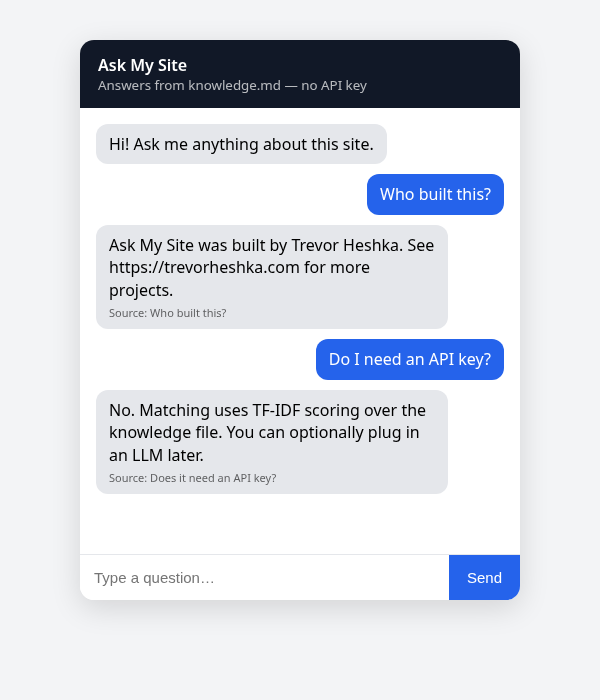
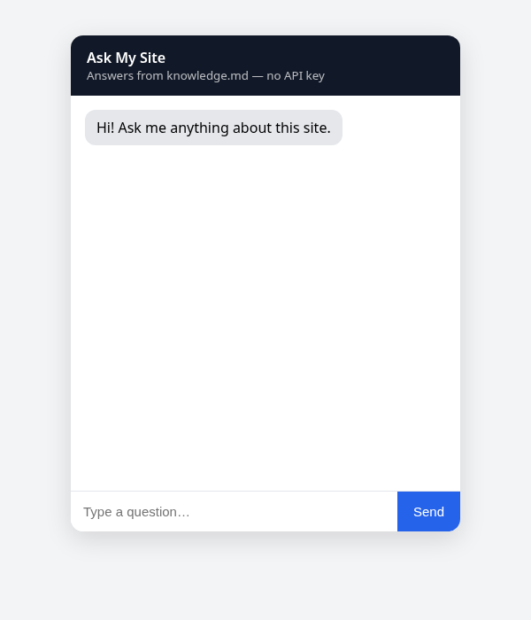

# Ask My Site

A minimal, self-hosted FAQ chatbot. One HTML chat widget plus a tiny Node server that answers questions from a single `knowledge.md` file using TF-IDF keyword matching. **No API key, no database, no dependencies.**

Built by [Trevor Heshka](https://trevorheshka.com).



## Prerequisites

- Node.js 18 or newer
- That's it

## Dependencies

None. The server uses only Node built-ins (`http`, `fs`, `path`). There is no `npm install` step.

## Install and run

```bash
git clone https://github.com/YardPhantom/ask-my-site.git
cd ask-my-site
npm start            # or: node server.js
# open http://localhost:3000
```

Set a different port with `PORT=8080 npm start`, or a different knowledge file with `KNOWLEDGE_FILE=/path/to/faq.md npm start`.

Run the tests with `npm test`.

## Editing the knowledge

Open `knowledge.md`. Each `## Heading` is one topic, and the text under it is the answer:

```markdown
## What are your hours?
We're open Monday to Friday, 9am to 5pm.
```

The server watches the file and reloads it when it changes. Headings count double when matching, so write them like the questions people ask.

## API

`POST /api/ask` with `{"question": "..."}` returns `{"answer": "...", "source": "<heading>", "score": 0.42}`. When nothing matches, `source` is `null`.

## Plugging in an LLM later (optional)

The matcher is in `answer()` in `server.js`. To use an LLM, take the top 2 or 3 matched sections as context and send them with the question to your provider of choice, reading the key from an environment variable (for example `process.env.LLM_API_KEY`). Never commit keys; `.env` is already in `.gitignore`.

## Screenshots

| Empty | Conversation |
|---|---|
|  |  |

## License

[MIT](LICENSE) © Trevor Heshka · https://trevorheshka.com

---

## Live app & author

- **Live:** [HeshBot (production version of this idea)](https://trevorheshka.com/)
- Built by [Trevor Heshka](https://trevorheshka.com/about/) · [Hesh Co.](https://trevorheshka.com/services/), Nanaimo, BC
- More projects: https://trevorheshka.com/projects/
